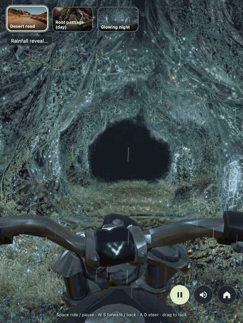
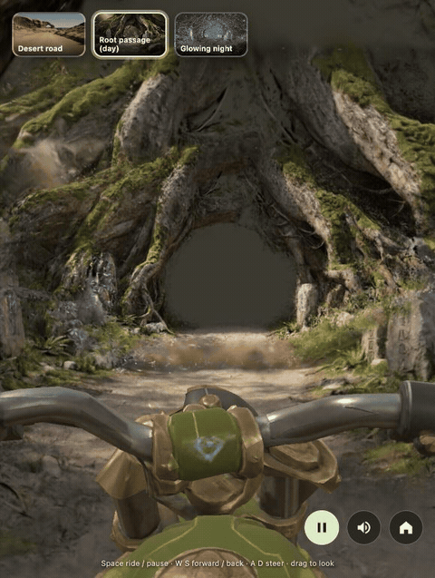
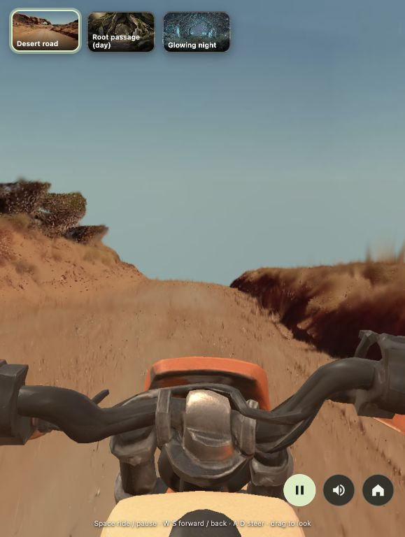
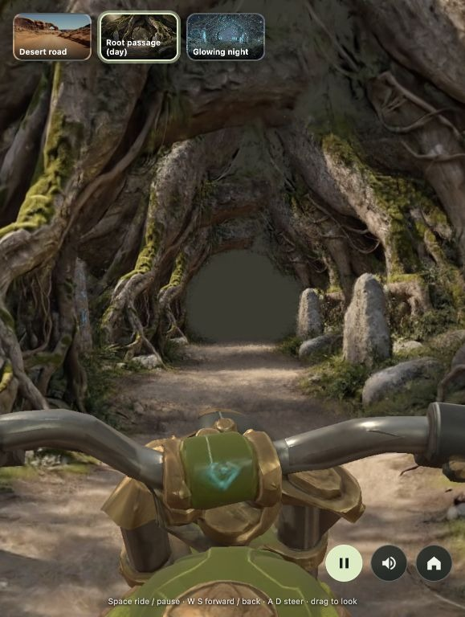

# Dune Rush

A browser dirt-bike prototype by **Arjun Behl and Ali**, built around **millions of 3D Gaussian splats**. Ride through a desert road, a daytime root passage and a glowing night passage, then watch a new world fall into place while you keep moving.

**4.69 million splat instances in the desert · Three worlds · A one-second rainfall reveal**

[Download and play](#download-and-run) · [Illustrated guide (PDF)](docs/Dune-Rush-Download-Instructions.pdf) · [Splat counts](#millions-of-splats-in-the-browser)

## Watch the world change

The scenery changes around the moving bike: incoming splats appear from top to bottom with a cyan glow, while the outgoing world fades away. The bike, sky and audio follow the same transition.

| Into the glowing night | Back to the desert |
| --- | --- |
|  |  |

These GIFs were captured from the running game. They have no audio.

The reveal operates on individual splats in 3D, using staggered columns to make the next world appear to rain into place. Both world tile sets participate during the switch, and movement continues throughout. The reveal itself defaults to **1 second**, after the incoming scene is loaded and prepared; reduced-motion mode switches without the animation.

## Millions of splats in the browser

The environments are made from 3D Gaussian splats: small, oriented, translucent shapes that combine into the road, rock formations, roots and glowing scenery. Three.js and Spark render them in the browser, alongside the bike and rider meshes.

| World | Unique splats in its tile | Tile copies | Splat instances across the copies |
| --- | ---: | ---: | ---: |
| Desert road | 1,564,494 | 3 | **4,693,482** |
| Root passage (day) | 605,277 | 4 | **2,421,108** |
| Glowing night | 634,062 | 4 | **2,536,248** |

The three source tiles contain **2,803,833 unique splats** in total. Copies share their source data and move around the camera to extend the ride. The instance totals count repeated tiles; they do not mean every splat is visible on screen at once.

During a desert ↔ night transition, the two participating tile sets contain **7,229,730 splat instances** combined, before visibility and opacity filtering. The transition changes each splat's opacity, scale and glow as the two environments exchange places.

Counts come directly from the bundled PLY headers and the copy lists in [`fantasy-worlds.json`](fantasy-worlds.json). The reveal is implemented in [`fantasy.html`](fantasy.html).

### Ride through the details



### Screenshots

| Desert road | Root passage (day) | Glowing night |
| --- | --- | --- |
|  |  |  |

[Download the illustrated setup guide (PDF)](docs/Dune-Rush-Download-Instructions.pdf). It includes MacBook download instructions, screenshots, clickable animation links and the three GIFs as attachments. The PDF pages show still frames; open the linked or attached GIFs to see motion.

## Download and run

1. Open [Releases](https://github.com/AliasgarTawa/dev-game/releases/latest) and download **dune-rush-ready-to-play.zip**. This ZIP contains the real assets, not Git LFS pointers.
2. Extract the ZIP and open a terminal in the extracted `dune-rush` folder.
3. With Python 3.10 or newer installed, run:

   ```sh
   python3 serve.py
   ```

   On Windows, use `py -3 serve.py`.

4. Open **http://127.0.0.1:17012/worlds-opening/** and click **Start Race**. Keep the terminal running while you play.

If that port is busy, run `python3 serve.py --port 17015` and use the URL printed in the terminal. Do not open the HTML as a `file://` URL. Loading the large splat scenes can take several seconds. Use a browser with WebGL2 and hardware acceleration enabled.

No Runpod instance, model-generation API, API keys, npm installation, or sibling project folder is needed to play. The menu can fetch Google Fonts and uses system fallbacks if unavailable. The game assets are bundled locally.

## Clone with every asset and experimental scene

Install [Git LFS](https://git-lfs.com/), then:

```sh
git lfs install
git clone https://github.com/AliasgarTawa/dev-game.git
cd dev-game
git lfs pull
python3 serve.py
```

The repository contains the source, original and optimized bike/mascot assets, audio, all local `fantasy-*` scene configurations and splat files, and the built three-world demo. Large PLY, GLB and FBX assets use Git LFS. GitHub's **Code → Download ZIP** may contain only LFS pointers. Use the ready-to-play release ZIP to play without Git or LFS.

## Controls

| Control | Action |
| --- | --- |
| Start Race | Enter the daytime root passage |
| Space | Start or pause riding |
| W / S | Move forward / back |
| A / D | Steer |
| Drag | Look around |
| World pictures | Switch worlds |
| Speaker button | Toggle audio |

## Project layout

- `fantasy.html`, `fantasy-rider.js`, `fantasy-audio.js`: current splat game, rider and sound mixer.
- `fantasy-worlds.json`: world settings and the starting world.
- `worlds-opening/`: ready-built menu with all runtime model, audio and image assets.
- `worlds-models/`: rigged bikes and mascot.
- `worlds-ui/`: three world-selection images.
- `vendor/`: bundled Three.js and Spark renderer modules.
- `src/`, `public/`, `index.html`: original Vite opening-screen source and assets, retained from the existing repository.
- `bike-game.html`, `js/`, `opening/`: earlier bike preview implementation.
- `assets/`: original models, source imagery and derived assets.
- `tools/`: Blender and asset-processing scripts. The playable demo uses their prebuilt output.
- `docs/PRESENTATION.md`: presentation content and implementation notes.

## Opening-screen development

The original opening-screen source remains editable with Node.js and npm:

```sh
npm ci
npm run dev
npm run build
```

These commands develop the original Vite menu. `python3 serve.py` serves the complete integrated game from `worlds-opening/` and `fantasy.html`.

## Prototype limits

Movement follows the road with limited lateral movement. Physics and collisions are not implemented. The splat worlds use substantial GPU memory, and performance depends on the browser and GPU. Sound needs a user click to start. Some close-up mesh/arm artifacts remain. The repository includes already-generated assets, not the cloud training environments or experiment backups used to create them.

Third-party libraries retain their original licenses. See `THIRD_PARTY_NOTICES.md`. Asset generation tools and services have their own terms. No additional blanket license is granted over supplied or generated artwork here.
