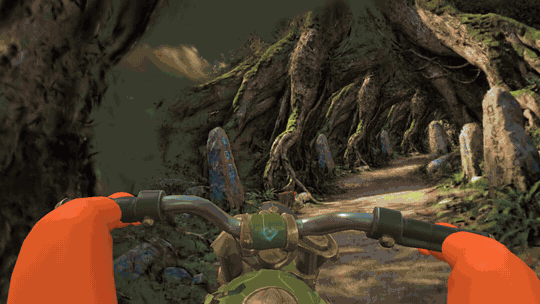
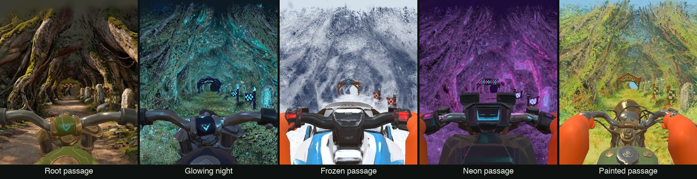
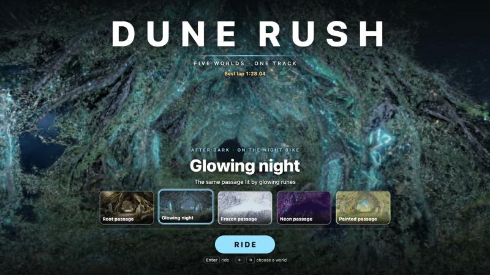
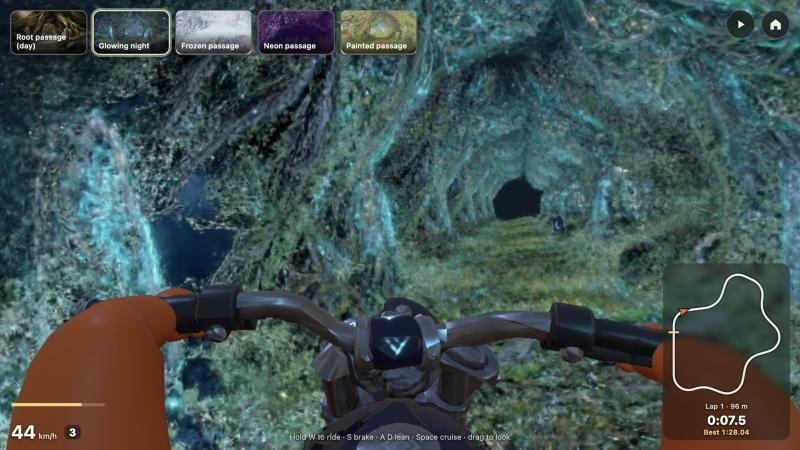
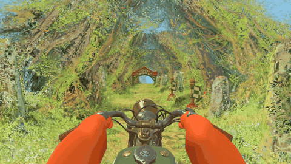
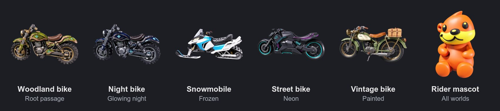
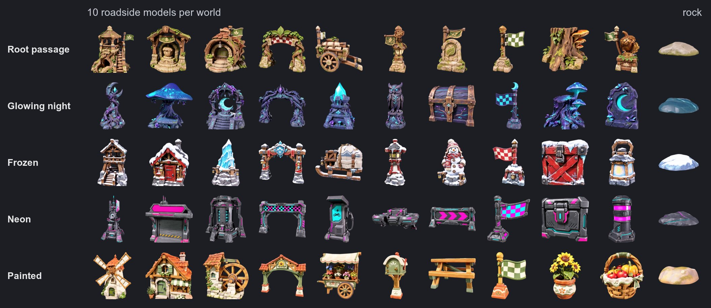

# Dune Rush

**One track. Five worlds. The world changes while you ride.**

A bike game that runs in the browser, built from 3D Gaussian splats by **Arjun Behl and Ali**.

### 🎮 [Play it online: dune-rush.onrender.com](https://dune-rush.onrender.com)

*Desktop Chrome recommended. The first visit downloads the five worlds (about 190 MB).*

[](https://drive.google.com/file/d/1i5IOV2fZ__yzW28d4k0ejvLv2-s9DbPW/view?usp=drivesdk)

### ▶ Watch the full demo (1:13, with sound)

https://github.com/user-attachments/assets/b0df6f29-b3f4-4bb8-9ea0-93b9b2ae8a83

*Press play above. For full quality, [watch it on Google Drive](https://drive.google.com/file/d/1i5IOV2fZ__yzW28d4k0ejvLv2-s9DbPW/view?usp=drivesdk).*

[Run it locally](#play-it) · [The idea](#the-idea-never-the-same-view-for-long) · [3D models (Meshy)](#3d-models-made-with-meshy) · [Numbers](#the-numbers)

## The idea: never the same view for long

The whole game is made from **one 12-metre stretch of road**.

That stretch is a splat tile of about half a million points. The game repeats it and bends it into a 1.4 km circuit. A loop that short should get boring in seconds. It doesn't, because the view keeps changing:

1. **One shape, five looks.** The original passage, mossy roots by day, was restyled four more times: the same roots glowing at night, frozen, neon, and painted countryside. Every look keeps the exact shape of the first one.
2. **So worlds can swap in place.** Because the shapes match, the game can replace one world with another while you are moving. The new world rolls in from the far end of the passage, one tile at a time, until it reaches you. It takes about two seconds while riding. The bike under you, the music and the roadside props change with it.
3. **The ride never stops.** The track, the stones you can hit, the physics and your lap time stay exactly the same through a switch. Only what you see and hear changes.

That is the trick: a tiny piece of world feels like a long journey, because you are never looking at the same thing for long. And a new world is cheap to add. It is a new look of the same road, not a new scene.



*The same spot on the track, five times. Each world brings its own vehicle and its own finish gate.*

## What is in the game

- **Five worlds**, each with its own vehicle (woodland bike, night bike, snowmobile, street bike, vintage bike), music and ambience.
- **A 1.4 km circuit** with a lap timer. Your best lap is saved in the browser.
- **50 roadside models**, ten per world: towers, shrines, a windmill whose sails turn, flags that wave, a finish gate. Plus five rocks on the road to ride over.
- **Real physics** for the bike against the stones at the side of the road (PhysX), five gears, 100 km/h top speed.
- **An opening that is the game itself**: the title sits over the live track while the worlds cycle behind it.

| Opening | Riding |
| --- | --- |
|  |  |



## 3D models made with Meshy

Every 3D model in the game started as a [Meshy](https://www.meshy.ai) model: 61 in all. That is the five vehicles, the rider, the 50 roadside models and the five rocks; the worlds themselves are splats. Each began as a reference image prepared for this project, and Meshy's image-to-3D (Meshy 7.1, PBR textures) turned it into a textured mesh. The pictures below are Meshy's own preview renders.



*The five vehicles and the rider mascot. The night bike is a Meshy 7 retexture of the woodland bike, so both share one mesh. In the game each vehicle is cut into parts in Blender so its handlebars steer. You ride in first person, so of the mascot you only see its arms; they were rebuilt in Blender with the Meshy texture so the paws hold the grips. The mascot's reference image was drawn from a photo of the original mascot.*



*Ten roadside models per world plus the rock you ride over. Each column fills the same spot on the track (tower, building, monument, finish gate, finish flag, then medium and small pieces), so a world switch swaps like for like. Meshy made the roadside models at up to about 31,000 triangles. The game uses lighter copies of 2,500 to 13,500 triangles each.*

## The numbers

| World | Splats in its tile | Copies on the track |
| --- | ---: | ---: |
| Root passage | 463,444 | 7 |
| Glowing night | 584,107 | 7 |
| Frozen passage | 592,352 | 7 |
| Neon passage | 585,095 | 7 |
| Painted passage | 575,475 | 7 |

- **2,800,473** splats across the five tiles. All five stay loaded, so once they are in, a switch never waits.
- Up to **1.0 million** splats drawn per frame. The game picks the detail level to hold the frame rate.
- Tile length **11.9 m**, lap length **1,396 m**.

The counts come from the tile files' own headers and from [`fantasy-worlds.json`](fantasy-worlds.json).

## Play it

The quickest way is the hosted copy at **[dune-rush.onrender.com](https://dune-rush.onrender.com)**. Its page and code are in [ArjunB3hl/dune-rush](https://github.com/ArjunB3hl/dune-rush), and the five world tiles are served from a public storage bucket.

To run it on your own computer instead:

You need Python 3.10 or newer and a desktop browser with WebGL2 (Chrome works well).

1. Download **dune-rush-ready-to-play.zip** from the [latest release](https://github.com/AliasgarTawa/dev-game/releases/latest) and unzip it.
2. In the unzipped `dune-rush` folder, run:

   ```sh
   python3 serve.py
   ```

3. Open **http://127.0.0.1:17012/** and press **Ride**.

On Windows use `py -3 serve.py`. If the port is busy, run `python3 serve.py --port 17015`. There is also a two-page [illustrated guide (PDF)](docs/Dune-Rush-Download-Instructions.pdf).

To work from the source instead, clone with [Git LFS](https://git-lfs.com/). The splat tiles and models are LFS files, so GitHub's "Download ZIP" button gives you placeholders, not the game. The full repository is several gigabytes because it also holds earlier experiments.

```sh
git lfs install
git clone https://github.com/AliasgarTawa/dev-game.git
cd dev-game
python3 serve.py
```

## Controls

| Key | Action |
| --- | --- |
| Enter | Ride (from the opening) |
| ← → | Choose a world in the opening |
| W | Ride |
| S | Brake |
| A / D | Lean |
| Space | Cruise |
| Drag | Look around |
| World pictures | Switch world while riding |

## Good to know

- The first world appears after a short loading screen. The other four load behind it; their cards light up as they arrive.
- Sound starts after your first click or key press.
- It is built and tested on a desktop. It needs a decent GPU.
- The best lap is saved per browser.

## Built with

[Three.js](https://github.com/mrdoob/three.js), [Spark](https://github.com/sparkjsdev/spark) for the splats and [PhysX](https://github.com/NVIDIA-Omniverse/PhysX) through [physx-js-webidl](https://github.com/fabmax/physx-js-webidl). The 3D models were made with [Meshy](https://www.meshy.ai). Licences are in [`THIRD_PARTY_NOTICES.md`](THIRD_PARTY_NOTICES.md). The artwork, models and audio were supplied or generated for this project and carry no blanket licence for reuse.

The game is `fantasy.html` with its `fantasy-*.js` modules, `fantasy-worlds.json` and the `worlds-*` folders. The rest of the repository holds earlier experiments and the source assets.
