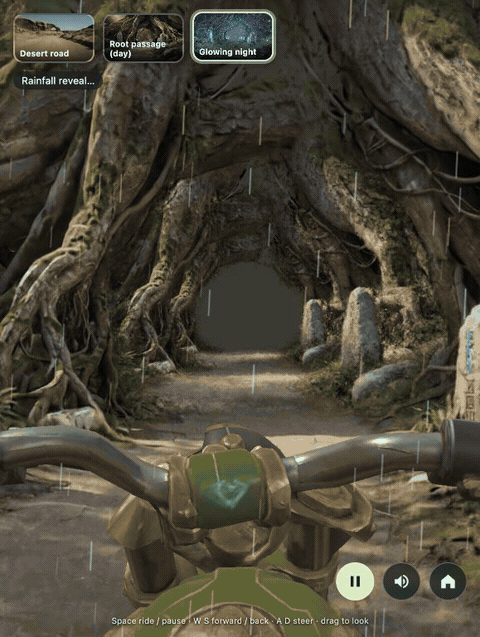
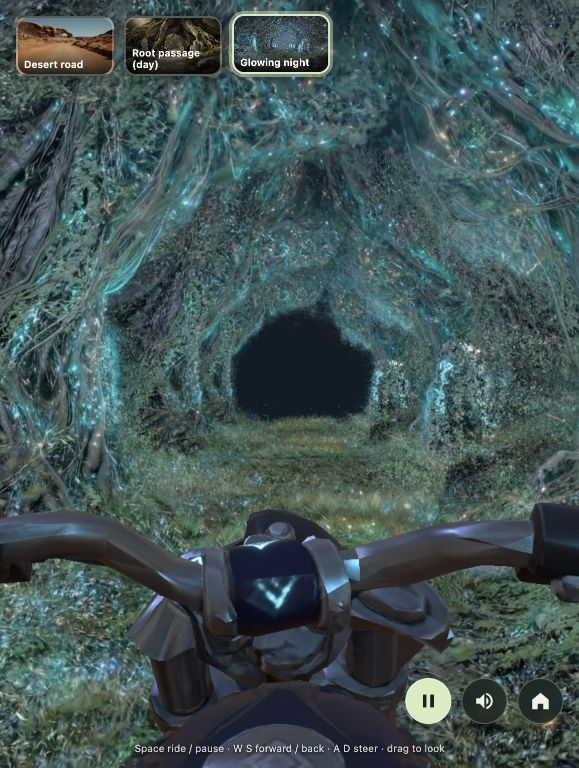

# Dune Rush

A browser dirt-bike prototype by **Arjun Behl and Ali**. Ride through a desert road, a daytime root passage, and a glowing night passage. Switch worlds while riding: the scenery, bike and audio change together.

## See the game

Live captures from the running demo. The GIFs show riding and world transitions; they have no audio.

| Daytime ride | Transition to glowing night | Transition to desert |
| --- | --- | --- |
|  |  |  |

### Screenshots

| Desert road | Root passage (day) | Glowing night |
| --- | --- | --- |
|  |  |  |

[Download the illustrated setup guide (PDF)](docs/Dune-Rush-Download-Instructions.pdf). It includes MacBook download instructions, screenshots, clickable animation links and the three GIFs as attachments. The PDF pages show still frames; open the linked or attached GIFs to see motion.

## Download and run

1. Open [Releases](https://github.com/AliasgarTawa/dev-game/releases/latest) and download **dune-rush-ready-to-play.zip**. This ZIP contains the real assets, not Git LFS pointers.
2. Extract the ZIP and open a terminal in the extracted `dune-rush` folder.
3. With Python 3.10 or newer installed, run:

   ```sh
   python3 serve.py
   ```

   On Windows, use `py -3 serve.py`.

4. Open **http://127.0.0.1:17012/worlds-opening/** and click **Start Race**. Keep the terminal running while you play.

If that port is busy, run `python3 serve.py --port 17015` and use the URL printed in the terminal. Do not open the HTML as a `file://` URL. Loading the large splat scenes can take several seconds. Use a browser with WebGL2 and hardware acceleration enabled.

No Runpod instance, model-generation API, API keys, npm installation, or sibling project folder is needed to play. The menu can fetch Google Fonts and uses system fallbacks if unavailable. The game assets are bundled locally.

## Clone with every asset and experimental scene

Install [Git LFS](https://git-lfs.com/), then:

```sh
git lfs install
git clone https://github.com/AliasgarTawa/dev-game.git
cd dev-game
git lfs pull
python3 serve.py
```

The repository contains the source, original and optimized bike/mascot assets, audio, all local `fantasy-*` scene configurations and splat files, and the built three-world demo. Large PLY, GLB and FBX assets use Git LFS. GitHub's **Code → Download ZIP** may contain only LFS pointers. Use the ready-to-play release ZIP to play without Git or LFS.

## Controls

| Control | Action |
| --- | --- |
| Start Race | Enter the daytime root passage |
| Space | Start or pause riding |
| W / S | Move forward / back |
| A / D | Steer |
| Drag | Look around |
| World pictures | Switch worlds |
| Speaker button | Toggle audio |

## Project layout

- `fantasy.html`, `fantasy-rider.js`, `fantasy-audio.js`: current splat game, rider and sound mixer.
- `fantasy-worlds.json`: world settings and the starting world.
- `worlds-opening/`: ready-built menu with all runtime model, audio and image assets.
- `worlds-models/`: rigged bikes and mascot.
- `worlds-ui/`: three world-selection images.
- `vendor/`: bundled Three.js and Spark renderer modules.
- `src/`, `public/`, `index.html`: original Vite opening-screen source and assets, retained from the existing repository.
- `bike-game.html`, `js/`, `opening/`: earlier bike preview implementation.
- `assets/`: original models, source imagery and derived assets.
- `tools/`: Blender and asset-processing scripts. The playable demo uses their prebuilt output.
- `docs/PRESENTATION.md`: presentation content and implementation notes.

## Opening-screen development

The original opening-screen source remains editable with Node.js and npm:

```sh
npm ci
npm run dev
npm run build
```

These commands develop the original Vite menu. `python3 serve.py` serves the complete integrated game from `worlds-opening/` and `fantasy.html`.

## Prototype limits

Movement follows the road with limited lateral movement. Physics and collisions are not implemented. The splat worlds use substantial GPU memory, and performance depends on the browser and GPU. Sound needs a user click to start. Some close-up mesh/arm artifacts remain. The repository includes already-generated assets, not the cloud training environments or experiment backups used to create them.

Third-party libraries retain their original licenses. See `THIRD_PARTY_NOTICES.md`. Asset generation tools and services have their own terms. No additional blanket license is granted over supplied or generated artwork here.
