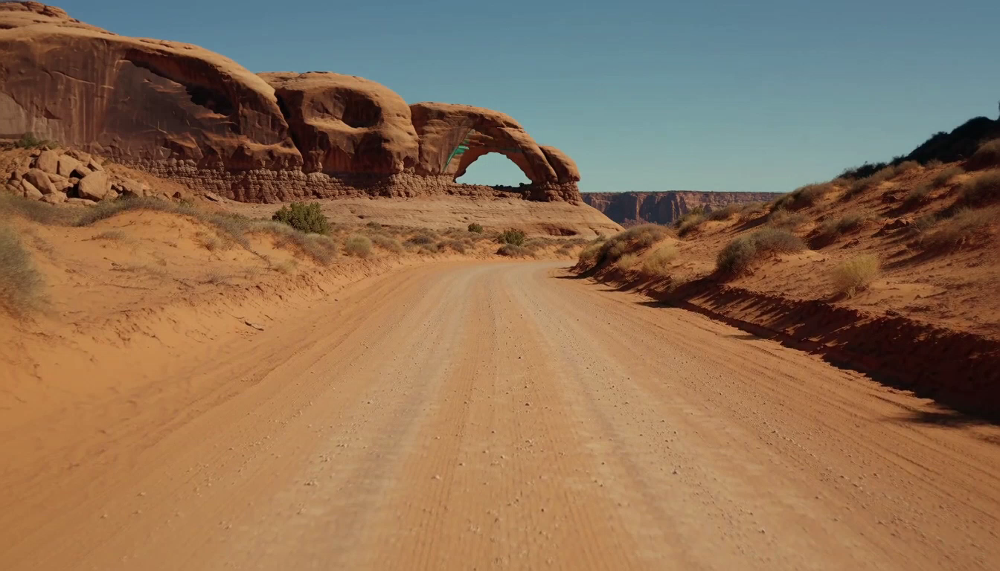

# Desert frames and opening-screen agent brief

Use these images for the game's opening screen and as image-conditioning references when generating more frames in the same style.

## Included assets

| Path | Purpose |
| --- | --- |
| `opening/first-frame.png` | Primary opening-screen image: the sandy road approaching the sandstone arch. Original source-clip start, 1344 × 768. |
| `opening/last-frame.png` | Original source-clip end; use as the starting reference when continuing that camera movement. |
| `reference-views/*.png` | 64 generated 1280 × 720 views of the road beyond the arch, covering forward, lateral, and downward views. |
| `contact-sheet.jpg` | Labeled overview of all 64 spatial views; for review, not a screen background. |
| `manifest.json` | Image dimensions, source provenance, and SHA-256 hashes. |

## Opening-screen implementation

1. Show `opening/first-frame.png` immediately as the background/poster while other resources load. Resolve the URL relative to the application's deployment base.
2. Keep the arch and road readable when cropping to narrow displays; inspect both portrait and landscape layouts. Use a separate subtle dark gradient behind title text and controls if needed.
3. Display the actual 3D bike and mascot on the opening screen: load `../models/desert-bike/desert-bike.glb` and `../models/mascot/rider.glb` (paths relative to this folder). Mount the orange, laptop-free mascot on the bike in a foreground 3D layer over the desert. Start from an over-the-shoulder composition, matching scale, perspective, and warm light to the scene. Keep both visible on desktop and mobile, with room for the title and Start button in a separate UI layer. These models are required on the opening screen itself, before gameplay; do not replace them with generated images.
4. For movement, use a temporally coherent continuation generated from the original frame, with this still as the loading/failure/reduced-motion fallback. Do not animate the numbered reference views in sequence: consecutive files often change position or look direction sharply.
5. Load only the chosen screen assets, rather than all 64 full-resolution reference views on startup. Show the desert poster immediately while the GLBs load, with a clear loading/error state. Derive optimized delivery copies as needed and retain the source PNGs and GLBs. The bike and mascot GLBs embed their resources and contain no animation clips; use a static pose or subtle whole-object idle motion, respecting reduced motion, unless rigging/animation is implemented separately.

## Visual style to preserve

Photographic red-sand desert; pale orange packed-sand road with subtle tyre ruts and small stones; ochre/red sandstone; dry golden grasses and sparse desert shrubs; low sandy shoulders and shadowed banks; distant flat-topped mesas; clear muted blue sky; strong natural daylight and consistent shadows. Keep natural texture and believable perspective. Avoid heavy stylization, oversaturation, haze that washes out the scene, or invented objects.

The arch belongs to the opening location. The 64 road views intentionally omit it so the later landscape can repeat without duplicating a landmark. Choose references for the location being extended.

## Generate additional matching frames

Use an image-conditioned generation tool with actual supplied images attached. Text alone is insufficient for matching the existing road and landmarks. For an opening variation, attach `opening/first-frame.png`. For a continuation, attach `opening/last-frame.png`. For a later road view, attach the closest one or several `reference-views/` images by position and look direction.

### Opening / arch prompt

> Continue the exact desert location in the supplied reference image. A natural photographic view from the road: pale orange packed sand with faint tyre ruts and small stones, warm red sandstone cliffs and the same distinctive arch in the same spatial relationship to the road, dry golden grass, sparse shrubs, distant mesas, and a clear blue sky. Preserve road width, terrain geometry, camera height, lens perspective, exposure, colour, sun direction, and shadows. For motion, advance slowly and smoothly along the existing road at constant eye height, with no cuts, sudden turns, zooms, or camera rise. Keep the landscape stable between frames. No people, vehicles, bikes, handlebars, signs, buildings, text, logos, or UI.

### Later road / repeating landscape prompt

The original 64-view generation used this prompt (supply depth only when a depth-conditioned workflow is actually available):

> A real photograph of a long straight dirt road through a red-sand desert on a clear sunny day, exactly the place and look of the reference photographs: a pale orange packed-sand road with faint tyre ruts and small stones, a low sandy verge with dry golden grass tufts and small desert shrubs on the left, a low red-earth bank with a dark shadowed cut, dry grass and scattered juniper bushes on the right, a distant flat-topped mesa on the horizon and a clear blue sky. The road keeps the same width, the same banks and the same harsh midday light all the way; the scenery repeats naturally along the road. Follow the supplied depth. All views show one identical place. Clean, sharp, natural, unstyled. No rock arches, no large rock formations near the road, no people, no vehicles, no signs, no text.

### Generation and review process

- Begin with a small pilot and compare it side by side with the selected source. Preserve aspect ratio; the original opening frames are 1344 × 768, while the road references are 1280 × 720.
- For a time sequence, generate a continuous shot, extract ordered frames, and inspect beginning/middle/end plus the transitions. Do not independently generate every frame with unrelated seeds.
- Reject shifting road edges, changing arches/rocks, flickering vegetation, altered shadows, floating fragments, blurred ground, and sudden camera-height or horizon changes.
- For a seamless animated loop, verify the end-to-start transition in motion. These reference views came from a spatial 40 m repeating-road experiment; that does not make them a ready-made temporal loop.
- Store additions under `generated/<sequence-name>/frame-0001.png` etc. Record the exact prompt, tool/model/version, reference paths, settings/seed when available, generation date, frame rate/order, and review outcome in a companion JSON or Markdown file.
- Keep generated alternatives separate until reviewed. Retain original images and their filenames.

## Provenance and limits

Packaged on 2026-11-14 from the existing local desert experiment. The opening images are the first and last frames of the user's source clip (`desert-2026-11-14/source-content.mp4`). The 64 road images are existing atlasGenerate outputs from `desert-2026-11-14/loop-tile-64/images/`; they used the last six frames of a generated forward continuation, with the arch cropped out, as context at their original poses and translated 40 m ahead. Eight pilot views were followed by 56 main views.

The desert folder contains 2 opening reference images and 64 road reference images, plus the contact sheet. The repository also includes the opening-screen bike and mascot GLBs under `assets/models/`. No new AI images were generated for this upload. Depth, camera calibration, splats, and training data are not bundled; these files alone are a visual reference package, not a complete reconstruction dataset. The opening-screen implementation and generation of additional images are tasks for the agent consuming this brief.
