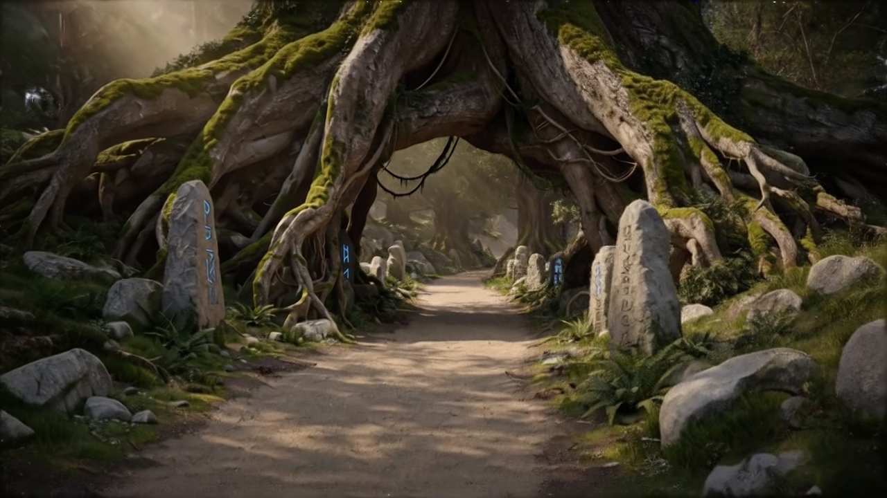
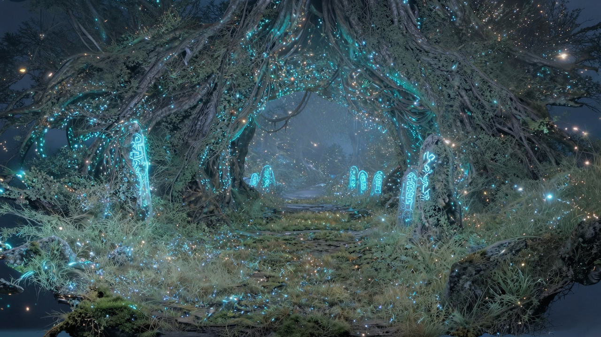
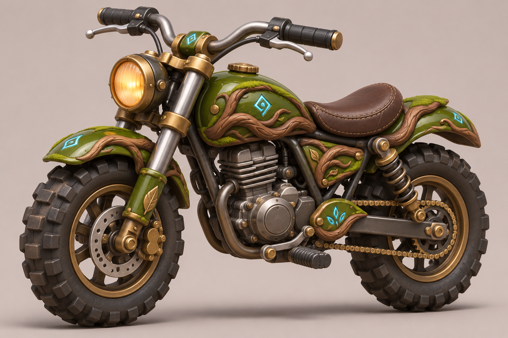
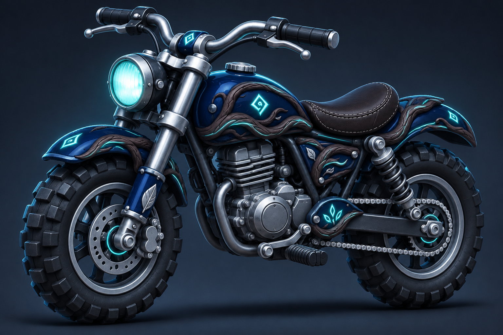

# Giant-root passage: day/night design and ElevenLabs audio brief

## Purpose and scope

Build a cohesive riding experience through an ancient giant-root passage. The same route, rider, bike silhouette and player position persist as the world changes between **Woodland Day** and **Glowing Night**. The user requested matching bike looks and audio guidance for both versions.

This is a production brief with ready-to-use generation prompts. **No audio has been generated by this change.** Music, durations and mixing values below are proposed creative settings, not already approved recordings or verified ElevenLabs API parameters. Check the selected ElevenLabs music/SFX model's current duration, looping and export support before submitting jobs; split assets if necessary. Obtain permission for paid audio generation before spending credits. This documentation request does not authorize audio calls.

## Visual references and design

| Element | Woodland Day | Glowing Night |
| --- | --- | --- |
| Passage | Enormous gnarled roots arch over a dusty path; moss, weathered stone markers and filtered warm daylight | The same root arches and marker positions; blue moonlight, cyan luminous runes and root veins, scattered tiny lights, mossy ground |
| Palette | Moss/olive green, earth brown, aged brass, warm amber; restrained blue runes | Midnight blue, dark wood, brushed silver, cyan/turquoise light |
| Bike | Compact fantasy scrambler; green panels, carved root relief, brown leather saddle, brass fittings and warm headlight | Same bike shape and controls; midnight panels, silver fittings, luminous cyan decorations and cool headlight |
| Feeling | Curious, welcoming woodland adventure; tactile and grounded | Magical discovery and quiet energy; mysterious but not horror |

### Environment references

Day (a render of the reconstructed daytime passage):

Night (a Chisel-generated restyled view used as a reference):

These are style references, not proof that every angle of the existing splat is complete. Preserve the route through a transition. Do not invent new obstacles or move the road while the bike is travelling.

### Bike references

The two concept images show a matching design. The local prototype already has a Meshy day bike and a night retexture with identical vertex positions and UVs, allowing its PBR textures to blend on one mesh. The bike must retain its wheelbase, saddle, grips and footrest positions during a look change. Keep the orange, laptop-free mascot recognizable and keep its head and arms readable from behind. Proper mascot rigging is a separate task; do not mistake the provisional static pose for a finished rig.

The associated local model paths are `assets/models/roots-bike/bike.glb` and `assets/models/roots-bike-night/bike.glb`. This brief commit includes reference images; it does **not** publish these new model files or the local viewer integration. Arrange those assets separately before implementing against a fresh clone. The existing desert opening-screen requirements in `AGENTS.md` still apply to that screen.

## Fit the existing GitHub audio system

Read [AUDIO.md](../AUDIO.md), `src/audio.js`, and `src/audio-effects.js` first. The current GitHub game already has the **Sunset Run** desert menu track (120 BPM), generated `bike-cruise.wav`, `bike-load.wav`, `sand-tires.wav`, procedural wind and a shared audio context with opt-in controls and saved mix settings.

Preserve the desert menu and its soundtrack. The proposed 96 BPM woodland pair belongs to the root-passage level; do not attempt a beat-matched 120 → 96 BPM transition with the menu track. Use a short non-rhythmic ambience bridge on level entry instead.

**Reuse the existing engine loops and wind first.** Audition the current sand tire loop against the day dirt path before ordering another. The SFX prompts below are specifications for missing or unsuitable assets, not an instruction to regenerate the entire existing set. Prioritize the two woodland music arrangements, day/night ambience, moss tires and transition cues. Add idle/start/stop/night-hum only where the gameplay needs them.

Extend the existing audio buses and lifecycle; do not create a second audio context. Continue the existing `onRide` speed/boost/throttle/roughness/pan inputs and capped 20 Hz control updates. Ship approved playable assets under `public/audio/roots/`; keep source masters and provenance under `assets/audio/roots/` or a separately managed asset store. Never expose an ElevenLabs key in Vite variables or invoke paid generation from the browser. Existing simulated shift cues belong to the boost preview; do not add arbitrary new gear events to the woodland ride.

## Music direction

Use original instrumental game music, without vocals, speech, recognizable borrowed melodies or named-artist imitation. Build two arrangements around a compatible motif and tonal centre so switching looks sounds intentional.

Recommended shared starting point: **96 BPM, 4/4, D Dorian**, with **16-bar / 40-second** loops. Day uses acoustic colours; night uses soft electronic and glass-like colours. This is a composition target: generated results must be checked for actual tempo, pitch and loop boundaries. Do not assume independent generations are sample-aligned stems.

| Game state | What plays |
| --- | --- |
| Scene loaded, before first user interaction | Silent; respect browser audio restrictions. Show an explicit sound toggle. |
| Player enables sound, stationary | Current ambience, sparse exploration music, engine idle only if the engine is on. |
| Start riding / accelerate | Keep the same music timeline; gradually bring in the riding percussion layer. Engine and tire layers respond immediately to motion. |
| Steady riding | Main current-style loop plus restrained riding layer; preserve room for mechanical and terrain sounds. |
| Coasting / braking | Riding layer eases down; engine load drops. Do not stop or restart the music for each key press. |
| Day → night | Keep playback positions; crossfade to the night arrangement and ambience, add one brief magical transition cue. |
| Night → day | Crossfade back at the same playback phase, use the warmer reverse-direction cue. |
| Stopped at the roadside | Remove rolling/wind layers, return to the sparse arrangement; retain idle if engine remains on. |
| Explicit pause / background tab | Fade out and suspend audio; resume cleanly from the stored timeline. Never stack duplicate loops. |

### ElevenLabs music prompt: Woodland Day

> Original seamless instrumental fantasy woodland exploration game music. A friendly motorcycle journey beneath enormous moss-covered tree roots and weathered rune stones in warm filtered daylight. Gentle plucked acoustic strings, woody marimba, soft hand percussion, a small breathy flute motif, warm restrained bass. Curious, adventurous, grounded, playful without sounding childish. Target 96 BPM, 4/4, D Dorian, a repeating 16-bar phrase lasting about 40 seconds. Maintain a steady understated groove suitable for continuous riding; no dramatic intro, final cadence, silence, vocals, speech, aggressive drums or cinematic trailer impacts. Leave sonic space for a small motorcycle engine. The end should connect naturally to the beginning.

### ElevenLabs music prompt: Glowing Night

> Original seamless instrumental fantasy night-riding game music, a companion arrangement to a warm woodland theme. The same giant-root passage is now midnight blue, with luminous cyan runes, glowing root veins and tiny drifting lights. Soft glass marimba, delicate bell-like plucks, airy sustained pads, warm round bass and muted electronic percussion. Magical, curious and gently propulsive, never frightening. Target the same 96 BPM, 4/4, D Dorian and 16-bar structure, about 40 seconds. Use a restrained repeating motif that can crossfade with an acoustic woodland arrangement. No vocals, speech, loud risers, harsh high-frequency sparkle, dramatic intro or final cadence. Leave room for the motorcycle engine; make a natural loop.

### Optional riding layer

Generate only if the primary arrangements need more motion. Use a separate percussion-only loop: soft frame drum and shakers for day; muted pulses and brushed electronic ticks for night. Match the shared tempo and bar length, with no melodic content. Verify phase/tempo compatibility before layering. If compatible stems cannot be produced, use a single arrangement per style and automate its gain/filter instead of layering mismatched music.

## Motorcycle and terrain sounds

These concepts are **motorcycles**, despite occasional use of the word “bicycle” in conversation. They need a compact scrambler engine and rubber tires, not pedal squeaks or a bicycle bell. Keep the underlying engine identity through the day/night switch. Night adds a subtle magical accent; it should not suddenly become a spaceship or a different vehicle.

Use close, dry, preferably mono vehicle recordings for stable attachment to the bike. Use stereo ambience/music. No baked music, crowd noise, wind or reverb inside the isolated engine assets.

| Filename / role | Prompt for ElevenLabs SFX | Target duration |
| --- | --- | --- |
| `bike-start.wav` | One compact friendly single-cylinder trail motorcycle starting: brief starter turnover, ignition catches, then settles into a gentle idle. Dry close recording, no other vehicle, no speech, no music. | 2–3 s |
| `bike-idle-loop.wav` | A small well-maintained single-cylinder scrambler motorcycle at a stable warm idle, soft rounded exhaust pulses and subtle mechanical ticking. Constant RPM, dry close recording, seamless loop, no acceleration, no music or ambience. | 6–10 s |
| `bike-low-loop.wav` | The same compact trail motorcycle engine under steady light load at low riding RPM. Smooth rounded putter, consistent pitch and level, dry isolated seamless loop. No gear changes, acceleration ramp or background sound. | 6–10 s |
| `bike-cruise-loop.wav` | The same compact single-cylinder scrambler engine at a stable moderate cruising RPM, controlled throaty hum, not a racing superbike. Dry isolated seamless loop, no horns, gear changes, passing motion or music. | 6–10 s |
| `bike-coast-loop.wav` | The same small trail motorcycle at steady low load with throttle released, gentle mechanical whirr and restrained exhaust pulses. Dry isolated loop with no large pitch changes or background noise. | 6–10 s |
| `tires-dirt-loop.wav` | Two rubber off-road motorcycle tires rolling steadily over fine dry dirt with sparse small gravel, soft granular crunch. Isolated constant-speed seamless loop, no engine, voices or music. | 6–10 s |
| `tires-moss-loop.wav` | Rubber off-road tires rolling over damp compact soil, moss and occasional soft leaves. Subtle low rustle, no splashes or dramatic squelches. Isolated constant-speed seamless loop, no engine or music. | 6–10 s |
| `ride-air-loop.wav` | Gentle continuous air movement from slow-to-moderate forward travel, soft broad whoosh with no buffeting, whistles or microphone distortion. Stable seamless isolated loop. | 6–10 s |
| `brake-soft.wav` | One brief gentle motorcycle brake application, restrained friction and a tiny mechanical click, no skidding, tire squeal, collision or engine. | 0.4–1 s |
| `bike-stop.wav` | A small single-cylinder motorcycle ignition switching off from idle, soft final engine pulses and a tiny mechanical settling click. Dry, close, no ambience. | 1–2 s |
| `night-bike-hum-loop.wav` | Very quiet magical cyan rune energy humming steadily within a small wooden-and-metal motorcycle, soft rounded tonal shimmer with slow subtle movement. Intimate and gentle, no sci-fi laser, electric arc, musical tune or sharp treble. Seamless isolated loop. | 6–10 s |

The scene's ground changes from dry dirt toward moss in the night restyle, so blend tire layers with the environment. If a future level preserves dry ground at night, keep the dirt layer instead. Vehicle sound follows **actual speed and throttle state**, not simply the held key. Reverse movement must not play the engine backwards. Do not add new gearshift, jump, skid or impact sounds until corresponding gameplay events exist; preserve existing boost-preview cues unless their integration is deliberately changed.

## Ambience and transition prompts

**`forest-day-loop.wav` — target 20–40 seconds:**

> Seamless stereo ambience inside an ancient forest passage beneath enormous arching roots, gentle leaf movement, occasional small distant bird calls, faint air moving through wood and foliage. Sheltered, warm daylight, peaceful and spacious. No footsteps, engines, music, voices, dramatic animal cries or close buzzing insects. No distinct beginning or ending.

**`forest-night-loop.wav` — target 20–40 seconds:**

> Seamless stereo ambience in the same sheltered root passage at magical night, soft night insects and distant woodland movement, faint leaf rustle, very sparse delicate glass-like twinkles from glowing runes. Calm, mysterious and safe, with plenty of quiet space. No horror stingers, owl calls dominating the mix, engines, footsteps, music or speech. Avoid incessant high-pitched glitter. No distinct beginning or ending.

**`transition-to-night.wav` — target 1–1.5 seconds:**

> One short soft top-to-bottom magical rainfall transformation: a gentle airy descending sweep with delicate cyan-crystal droplets, ending in a warm low shimmer. Elegant, restrained and satisfying, no thunder, explosion, harsh hiss, dramatic trailer hit, melody or speech. Leave a short soft tail.

**`transition-to-day.wav` — target 1–1.5 seconds:**

> One short gentle magical return to warm daylight: airy drifting particles with soft woody chimes, resolving into a subtle warm breath of wind. A companion to a descending crystal rainfall transformation, softer and more organic. No dramatic impact, thunder, harsh sparkle, melody or speech. Short soft tail.

## Synchronization and mix implementation

1. Preload/decode both music loops and essential vehicle loops. Start audio only after a user gesture. Track music, ambience and SFX on independent gain buses, with master mute and persistent volume settings.
2. Start corresponding day/night music loops against the same audio clock if their beat grids truly match. Use equal-power gains (`day = cos(p × π/2)`, `night = sin(p × π/2)`) for the look blend. Do not restart either track on each transition. If matching composition grids are unavailable, make an unobtrusive ambience bridge rather than pretending unrelated loops are synchronized.
3. Trigger the transition cue and music/ambience crossfade when the actual visual reveal begins, **after model/splat loading**, not immediately when the button is clicked. Follow the visual reveal's progress and direction; the local prototype currently defaults to roughly one second. A stalled load must not make the sound arrive several seconds before the image.
4. On a failed switch, retain or restore the old audio state. Ignore repeated switch clicks while transitioning. Direct night entry begins with the night mix after audio is enabled; it must not briefly play day music first.
5. With reduced motion, switch the visual immediately and use a short 100–250 ms audio crossfade to avoid clicks. Audio volume controls remain available regardless of animation settings.
6. Blend idle/low/cruise/coast engine loops with smoothed throttle/load and absolute speed. Use modest playback-rate variation only (starting experiment: approximately 0.85–1.2); distinct recorded loops should carry most of the RPM change. Smooth gain/pitch updates over roughly 80–150 ms to prevent stepping. Wind and rolling sounds fade to zero at rest; idle remains only while the engine is on.
7. Increase the riding percussion gradually over about 1–2 seconds after sustained motion. Keep engine, tires and ambience audible through the mix without turning the music into a loud background wall. Use short master fades for pause/resume and mute.
8. Keep engine sound centred near the rider/bike; place optional forest emitters in world space. Do not pretend the bike has physically accurate spatial reverberation while it remains a separate foreground render pass.

Suggested listening balance: music as the gentle bed, engine clearly perceptible but comfortable, tire/wind layers below it, and night hum barely audible. Briefly duck music by about 2–3 dB for the transition cue if necessary. Avoid clipping and sudden loudness jumps; judge the final mix on laptop speakers, headphones and a phone. Preserve clean source exports, ideally WAV at 48 kHz where supported, and create compressed browser copies as needed. Do not merely relabel or upsample a lower-quality export and claim improved fidelity.

## Deliverables and acceptance checks

Save approved source audio under `assets/audio/roots/` with a manifest recording provider/model, exact prompt, actual duration, sample rate, channels, observed credit cost, loop points and generation ID. Keep credentials out of prompts, manifests and Git. Store browser-ready copies separately from source masters if size requires it.

- Two compatible music arrangements; separate riding layer only if demonstrably synchronized.
- Two environment loops, a consistent engine loop set, two tire textures, optional quiet night hum, start/stop/brake and both transition cues.
- Listen to at least three loop repetitions: no seam click, inserted silence, unwanted cadence, baked speech or engine pitch jump.
- Verify idle → accelerate → cruise → brake → stop, and repeat transitions while stationary and moving.
- Check cold night load, failed/delayed load, muted state, reduced motion, pause/resume and a background tab. No duplicated loops or audio continuing after pause.
- Confirm the day/night change is clearly audible but does not overpower the game or imply a different motorcycle.
- Review bike/environment visual alignment separately from the audio. The soundtrack cannot fix splat holes, a rough mesh or an unfinished rider rig.
